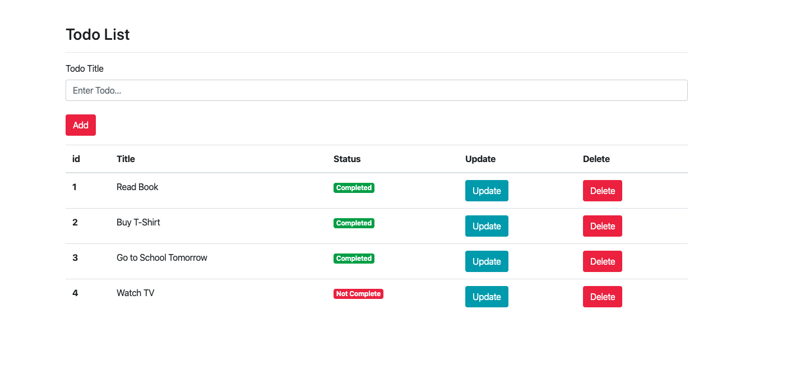

# Todo App

This is a simple task management application built with Python and Flask.

## Screenshot



## Features

- Add tasks
- Mark tasks as completed
- Delete tasks

## Installation

Install the dependencies:

```powershell
python -m pip install -r requirements.txt
```

## Run the Application

Start the application:

```powershell
python main.py
```

Then open the application in your browser:

http://127.0.0.1:5000

## Project Structure

- `config/` – Database configuration
- `data/` – Database and log files
- `examples/` – Example files
- `static/` – CSS files and images
- `storage/` – Data storage and logging
- `templates/` – HTML templates
- `main.py` – Main application
- `requirements.txt` – Python dependencies

## Technologies

- Python
- Flask
- Flask-SQLAlchemy
- SQLite
